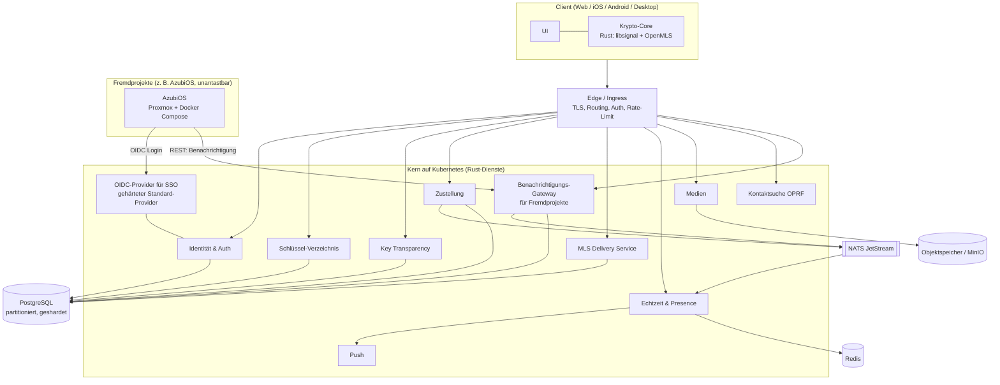

# Pflichtenheft

**IT-Ausbildung Kladow**

| Feld | Inhalt |
|------|--------|
| Projektbezeichnung | SecureMessenger (Arbeitstitel, frei ersetzbar) |
| Dokumenttyp | Pflichtenheft |
| Bezug | Lastenheft SecureMessenger, Version 1.2 |
| Auftragnehmer | Hr. Schiller |
| Erstellt am | 30.06.2026 |
| Aktuelle Version | 1.3 |
| Status | Entwurf zur Abnahme |

### Änderungsverlauf

| Nr. | Datum | Version | Autor | Geändertes Kapitel | Art der Änderung | Status |
|-----|-------|---------|-------|--------------------|------------------|--------|
| 1 | 30.06.2026 | 1.0 | Kai Delor | Alle | Erstellung | Entwurf |
| 2 | 30.06.2026 | 1.1 | Kai Delor | 5.1, 5.2, 5.3, 8, 9, 13 | Kritische Punkte gelöst: OIDC-Provider entschieden (Standard-Provider), SSO-SPOF gehärtet, SLOs und Incident-Response ergänzt, On-Premise gegen SVR und Push aufgelöst, KT-Auditor-Default, Wurzelschlüssel-Recovery skizziert | Entwurf |
| 3 | 02.07.2026 | 1.2 | Kai Delor | 8.6, 8.7 | SLOs auf 24/7 umgestellt (Fehlerbudget 3,6 h/Monat), Bereitschafts-Frage für den 24/7-Betrieb geschärft, Kapazitätsformulierung vereinheitlicht | Entwurf |
| 4 | 02.07.2026 | 1.3 | Kai Delor | 11 | Externer Spec-Review vom Code-Start auf den Produktivbetrieb verschoben (ADR-0008), Phase 0 entsprechend angepasst | Entwurf |

---

## 1 Einleitung

Dieses Pflichtenheft beantwortet das Lastenheft. Wo das Lastenheft das Was und Warum festlegt, beschreibt dieses Dokument das Wie: die Architektur, den Technologie-Stack, die Schnittstellen, das Datenmodell, den Betrieb und den Umsetzungsplan. Jede Lösung verweist auf die Anforderung, die sie erfüllt (F-Nummern und NF-Nummern aus dem Lastenheft).

Eine Festlegung steht über allem und prägt jede folgende Entscheidung: Die Kryptografie wird nicht selbst gebaut. Sie kommt aus geprüften Bibliotheken über einen gemeinsamen Rust-Core. Das Backend hält und verteilt nur Chiffretext. Dasselbe Prinzip gilt über die Krypto hinaus für jeden sicherheitskritischen Standard-Baustein, etwa den Anmeldedienst (Abschnitt 5.2).

## 2 Allgemeines

### 2.1 Bezug zum Lastenheft und Vorgehen

Das Projekt folgt einer Spec-Phase vor dem Code. Die kryptografisch heiklen Teile sind spezifiziert (siehe Ordner [specs/](specs/)) und werden extern gegengelesen, bevor Produktivcode entsteht. Erst danach beginnt die Umsetzung entlang der Phasen aus Kapitel 11. Diese Reihenfolge ist kein Formalismus, sondern senkt das Risiko an genau der Stelle, an der Fehler am teuersten sind.

### 2.2 Grundentscheidungen

1. **Krypto aus geprüften Bibliotheken über einen Rust-Core.** libsignal für PQXDH, Double Ratchet und SPQR, OpenMLS für Gruppen, beide auf konkrete Commits gepinnt.
2. **Backend und Core in einer Sprache, Rust.** Begründung in Abschnitt 4.1.
3. **Zwei Dinge sind nachprüfbar, die Schlüssel und der Code.** Key Transparency gegen falsche Schlüssel, Binary Transparency gegen eine manipulierte App.
4. **Ein Betreiber, föderationsfähig geschnitten.** Föderation bleibt vorbereitet, aber abgeschaltet, weil ein einzelner Betreiber die Metadaten am besten schützt.
5. **Basis-Rolle über Standard-Protokolle.** Andere Projekte binden den SecureMessenger über OpenID Connect, REST und Webhooks ein, ohne ihren eigenen Stack zu ändern.

## 3 Systemüberblick

Das Backend besteht aus einer Handvoll zustandsarmer Rust-Dienste, jeder mit einer klaren Aufgabe und für sich skalierbar. Die Krypto läuft nicht im Backend, sondern im Rust-Core auf den Clients, gebaut als WebAssembly für den Web-Client und als native Bibliothek über FFI für Mobile und Desktop. Clients reden über eine Edge-Schicht mit dem Kern: REST für alles, was der Client auslöst, eine dauerhafte WebSocket-Verbindung für alles, was der Server von sich aus meldet.



### 3.1 Die Dienste

| Dienst | Aufgabe | Erfüllt |
|--------|---------|---------|
| Edge / Ingress | TLS-Terminierung, Routing, Auth-Prüfung, Rate-Limiting, WebSocket-Verbindungen | NF070, NF080 |
| Identität & Auth | Konten, Login, Sessions, Geräteverwaltung | F010 bis F050 |
| OIDC-Provider | Single Sign-on für Fremdprojekte, gehärteter Standard-Provider | F060, NF060 |
| Benachrichtigungs-Gateway | Nimmt Benachrichtigungs-Aufträge von Fremdprojekten an und stellt sie zu | F070, F080, F100 |
| Schlüssel-Verzeichnis | Prekey-Bündel je Gerät, klassisch und post-quantum, Sender-Credentials | F110 |
| Key Transparency | Prüfbares Schlüssel-Log samt Auditor-Schnittstelle | F120, F130 |
| Zustellung | Nimmt Chiffretext an, legt ihn ab, stellt zu (store-and-forward) | F140, F160, F170 |
| MLS Delivery Service | Verteilt Handshake- und Anwendungsnachrichten der Gruppen | F150 |
| Echtzeit & Presence | WebSocket-Fanout, Online-Status, Tippanzeigen | F200, F080 |
| Medien | Verschlüsselte Datei-Uploads im Objektspeicher | F180 |
| Kontaktsuche | Löst Handles per OPRF auf | F190 |
| Push | Weckt mobile Geräte über APNs und FCM | F200 |

## 4 Technologie-Stack

### 4.1 Programmiersprache: Rust (Begründung)

Die selbst entwickelten Backend-Dienste werden in Rust geschrieben, nicht in Go. Drei Gründe tragen diese Wahl:

- **Eine Sprache über Core und Backend.** Der Krypto-Core ist ohnehin Rust (libsignal, OpenMLS). Mit Rust im Backend teilen Core und Dienste dieselbe Sprache, dieselben Wire-Typen und dieselben Test-Werkzeuge.
- **Speichersicherheit ohne Garbage Collector.** Ein Messaging-Server hat eine große Parser- und Wire-Angriffsfläche. Rust schließt eine ganze Fehlerklasse (Use-after-free, Buffer Overflows, Daten-Races) zur Compile-Zeit aus, ohne GC-Pausen, die bei vielen WebSocket-Verbindungen stören würden.
- **Reifes Async-Ökosystem.** tokio trägt die nebenläufige Last, axum die REST-Schicht, tokio-tungstenite die WebSockets. Das skaliert je nach Ausstattung auf zehntausende bis hunderttausende Verbindungen je Knoten (NF080).

Eine Ausnahme ist bewusst zugelassen: Der OIDC-Provider ist ein erprobter Standard-Dienst und kein Rust-Eigenbau (Begründung in 5.2). Hier wiegt das Prinzip „kein Eigenbau bei Sicherheit" schwerer als das Ein-Sprachen-Ziel.

### 4.2 Bausteine je Schicht

| Schicht | Wahl | Anmerkung |
|---------|------|-----------|
| Async-Runtime | tokio | Grundlage aller Dienste |
| REST / HTTP | axum (auf hyper/tower) | OpenAPI über utoipa |
| WebSocket | tokio-tungstenite | Echtzeit-Hinweise |
| Interner Dienst-zu-Dienst-Verkehr | gRPC über tonic, wo nötig | sonst REST intern |
| Datenbank | PostgreSQL über sqlx | Schemata pro Dienst, siehe Kapitel 7 |
| Cache / Presence / Zähler | Redis über redis-rs | flüchtiger Zustand |
| Queue / Fanout | NATS JetStream über async-nats | Zustell- und Benachrichtigungs-Fanout |
| Objektspeicher | MinIO (S3-kompatibel, on-premise) | verschlüsselte Medien (NF120) |
| SSO / OIDC-Provider | gehärteter Standard-Provider (z. B. Keycloak) | kein Eigenbau, siehe 5.2 |
| Krypto-Core | libsignal, OpenMLS, gepinnt | kein Eigenbau |
| Metriken / Tracing | Prometheus-Client, OpenTelemetry | NF100 |

### 4.3 Betriebs-Stack

Docker für die Container, Kubernetes für die Orchestrierung, beide auf dem Proxmox-Cluster (NF120). Details in Kapitel 8.

## 5 Lösungskonzept je Modul

### 5.1 Identität, Konten und Geräte (F010 bis F050)

Ein Konto hängt an einem eindeutigen Handle, der Anzeigename ist davon getrennt. Bei der Registrierung entstehen der Konto-Identitätsschlüssel (Ed25519) und das erste Gerät. Jedes weitere Gerät bekommt eigene Schlüssel, gebunden über ein vom Konto-Identitätsschlüssel signiertes Credential, das in der Key Transparency sichtbar ist (F040). Ein neues Gerät wird von einem bestehenden freigeschaltet, der Verlauf reist verschlüsselt von Gerät zu Gerät, der Server reicht keinen Klartext durch.

Sessions laufen über kurzlebige Access-Token und rotierende Refresh-Token (F020). RBAC (F050) setzt der Identitäts-Dienst durch und prüft die Edge-Schicht bei jeder Anfrage.

**Kompromittierung des Wurzelschlüssels.** Der Konto-Identitätsschlüssel ist die Wurzel des Vertrauensbaums, sein Verlust ist der härteste Fall. Der Recovery-Pfad:

1. Eine Revocation als eigener Eintrag in der Konto-Historie der Key Transparency macht die Kompromittierung öffentlich, sodass Kontakte den alten Schlüssel als ungültig sehen.
2. Ein neuer Wurzelschlüssel wird ausgestellt, alle Geräte-Credentials werden neu signiert.
3. Die Safety Numbers gegenüber allen Kontakten werden zurückgesetzt, was bei diesen eine sichtbare Re-Verifikation auslöst.

Solange der alte Schlüssel nur abgelaufen und nicht kompromittiert ist, signiert er den neuen (Übergabekette). Bei echter Kompromittierung fehlt diese Kette, weshalb hier eine Out-of-band-Bestätigung nötig ist. Die genaue Mechanik dieses Falls steht in [specs/geraete-identitaet.md](specs/geraete-identitaet.md) und gehört zum Audit-Umfang.

### 5.2 Basis-Dienste für andere Projekte (F060 bis F100)

Dieses Modul macht aus dem Messenger ein Fundament. Hier sind drei Begriffe sauber zu trennen, weil ihre Vermischung das häufigste Missverständnis wäre.

**Zwei Identitätsbegriffe, nicht einer.** Der SecureMessenger kennt eine kryptografische Identität (Konto-Identitätsschlüssel, Geräte-Credentials, Key Transparency) und eine Anmelde-Identität (wer ist gerade eingeloggt). SSO für Fremdprojekte nutzt nur die zweite. Ein Drittprojekt erfährt über SSO, dass ein bestimmter Nutzer angemeldet ist, es bekommt niemals private Schlüssel oder die Fähigkeit, Inhalte zu lesen.

**SSO über einen erprobten OIDC-Provider (F060).** Der Anmeldedienst wird nicht selbst implementiert. OIDC sicher und vollständig umzusetzen (Token-Signaturen, Flows, Schlüsselrotation, Angriffsklassen wie Token-Replay und Mix-up) ist ein eigenes Sicherheitsfeld, und das Leitprinzip „kein Eigenbau bei Sicherheit" gilt hier genauso wie bei der Krypto. Deshalb kommt ein gehärteter Standard-Provider zum Einsatz (Default: Keycloak), betrieben als eigener Dienst im Cluster, an den der Identitäts-Dienst seine Konten anbindet. Der Trade-off ist bewusst: Es kommt eine zweite Laufzeit (JVM) hinzu, was dem Ein-Sprachen-Ziel widerspricht. Der Gewinn an Sicherheit und Wartbarkeit wiegt das auf. **[ANNAHME: Keycloak als Default. Ein eigener Rust-OIDC-Dienst bliebe eine Option, falls die JVM-Laufzeit betrieblich unerwünscht ist; diese Wahl ist vor M3 final zu bestätigen.]**

**SSO als Single Point of Failure.** Weil alle abhängigen Projekte über diesen Dienst anmelden, legt sein Ausfall sie alle lahm. Drei Maßnahmen federn das ab:

- Der OIDC-Provider läuft redundant mit mehreren Repliken, kein einzelner Pod.
- Er bekommt das strengere Verfügbarkeitsziel aus NF060 (99,9 Prozent).
- Die ausgestellten Tokens haben eine Gültigkeit, die einen kurzen Ausfall überbrückt, sodass bereits angemeldete Nutzer in den Fremdprojekten nicht sofort hinausfliegen (NF160).

Da die Fremdprojekte unantastbar sind, liegt diese Resilienz allein auf der Messenger-Seite.

**Benachrichtigungen, klar abgegrenzt (F070).** Eine Benachrichtigung von AzubiOS (etwa „Bericht freigegeben") kommt von einem Server, nicht von einem Nutzer. Sie kann darum nicht dieselbe Ende-zu-Ende-Eigenschaft haben wie ein Nutzer-Chat, weil der Absender eine Maschine ist. Daraus folgt die Konstruktion: System-Benachrichtigungen laufen über einen getrennten Kanal, klar als Maschinen-Benachrichtigung markiert, mit minimalem Inhalt. Der Hinweis trägt nur „AzubiOS: neue Aktivität", die Details holt der Nutzer im Fremdprojekt selbst. So bleibt der vertrauliche Chat sauber getrennt von der Maschinen-Benachrichtigung, und der Server lernt aus dem Benachrichtigungstext nichts Sensibles.

**Präsenz-Abruf (F080).** Ein Fremdprojekt fragt den Online-Status eines Nutzers über eine rate-limitierte REST-Schnittstelle ab, soweit der Nutzer das in seinen Einstellungen erlaubt.

**Chat als Modul (F090).** Die Chat-Funktion steht über die dokumentierte REST-API und ein einbettbares Client-Modul bereit. Ein Projekt wie AzubiOS aktiviert oder deaktiviert dieses Modul, wie es sein Lastenheft ohnehin vorsieht.

**Mandantenfähigkeit (F100).** Jedes Fremdprojekt erhält einen eigenen OAuth2-Client mit eigenem Geheimnis, einem Mandanten-Scope und eigenem Rate-Limit. Projekte stören sich dadurch nicht gegenseitig, und ein kompromittiertes Projekt-Token bleibt auf seinen Mandanten begrenzt.

### 5.3 Schlüssel-Verzeichnis und Key Transparency (F110 bis F130)

Jedes Gerät hinterlegt einen Prekey-Pool, klassisch und post-quantum (rund 100 Einmal-Prekeys je Typ, Nachfüllen ab 20 verbleibenden, signierte Prekeys wöchentlich rotiert). Der Abruf ist pro Abrufer rate-limitiert, die Einmal-Prekeys werden atomar gezogen (`SELECT ... FOR UPDATE SKIP LOCKED`), damit zwei gleichzeitige Sitzungsaufbauten nicht denselben Prekey verbrauchen.

Key Transparency führt ein prüfbares Log aller Schlüssel. Der Client gleicht jeden ausgelieferten Schlüssel automatisch gegen einen Inklusionsbeweis ab (F120). Safety Numbers erlauben den manuellen Abgleich, ein Schlüsselwechsel löst eine sichtbare Warnung aus (F130).

**Auditor-Governance gegen den Split-View.** Die Client-Selbstprüfung fängt ab Phase 1 jeden offenen Schlüsseltausch. Den Split-View (der Server zeigt verschiedenen Leuten verschiedene Verzeichnisse) fängt erst die Auditor- und Gossip-Schicht. Damit dieser Schutz nicht an einer offenen Governance-Frage hängt, gilt ein gestufter Default: Client-Gossip (Clients und Auditoren vergleichen ihre signierten Wurzeln) ist ab Phase 3 verbindlicher Mindestschutz, weil er ohne externe Organisation auskommt. Ein unabhängiger externer Auditor (Hochschule, Verein oder zweite Instanz) ist das erklärte Ziel und wird angestrebt, sobald verfügbar. Solange er fehlt, weist das Bedrohungsmodell aus, dass der Split-View-Schutz reduziert ist. **[OFFENE FRAGE: Wer betreibt den unabhängigen Auditor.]**

### 5.4 Nachrichten (F140 bis F170)

- **Sitzungsaufbau und laufende Sitzung (F140).** Der Sitzungsaufbau läuft über PQXDH (hybrid aus X25519 und ML-KEM-768), die laufende Sitzung über Double Ratchet plus den post-quantum Anteil SPQR.
- **Hybride Bindung (NF050).** Die Bindung beider Anteile ist die heikelste Stelle und wird 1:1 aus der libsignal-Spec übernommen, nicht selbst konstruiert; sie ist Schwerpunkt des ersten externen Audits.
- **Gruppen (F150).** Gruppen laufen über MLS (RFC 9420) mit OpenMLS und sind klassisch, bis der PQ-Combiner in OpenMLS landet.
- **Zustellung (F160).** store-and-forward bis zur Abholung, idempotent über eine client-erzeugte ID.
- **Sealed Sender (F170).** Verbirgt den Absender, die Sende-Berechtigung wird über ein anonymes Credential geprüft, ohne dass der Server das Absenderkonto lernt.

### 5.5 Medien, Kontaktsuche, Echtzeit (F180 bis F200)

Medien werden client-seitig verschlüsselt und als Blob in den Objektspeicher geladen, der Schlüssel reist in der Nachricht (F180). Die Kontaktsuche löst ein Handle per OPRF auf, ohne dem Server den Suchverlauf zu verraten (F190). Die Echtzeit-Schicht schickt über WebSocket nur Hinweise, den Chiffretext holt der Client danach selbst (F200).

### 5.6 Clients und Lieferkette (F210, F220)

Der Web-Client nutzt den Rust-Core als WebAssembly, die nativen Clients über FFI (F210). Die Builds sind reproduzierbar und signiert, ihre Prüfsummen landen im Binary-Transparency-Log (F220). Der Web-Client wird ausdrücklich als das kryptografisch schwächste Glied behandelt und nicht mit den nativen Clients gleichgesetzt, weil im Browser der OS-Keystore fehlt und ausgeliefertes JavaScript ohne Binary Transparency austauschbar wäre.

## 6 Schnittstellen

Bodies sind JSON, Binärdaten Base64-kodiert. Authentifiziert wird per `Authorization: Bearer <token>`. Jedes Feld steht verbindlich in der OpenAPI-Spezifikation, die mit dem Backend ausgeliefert wird.

### 6.1 Client-API (Auszug)

| Endpunkt | Zweck |
|----------|-------|
| `POST /accounts` | Konto mit Handle anlegen, erstes Gerät registrieren |
| `POST /sessions`, `/sessions/refresh`, `DELETE /sessions` | Login, Erneuern, Logout |
| `GET /devices`, `POST /devices`, `DELETE /devices/{id}` | Geräte verwalten |
| `GET /keys/{handle}`, `POST /keys/prekeys` | Prekey-Bündel abrufen, Pool nachfüllen |
| `GET /kt/proof/{handle}`, `/kt/epoch/{n}`, `/kt/consistency` | Key-Transparency-Beweise |
| `POST /messages`, `GET /messages`, `POST /messages/ack` | Nachrichten senden, abholen, bestätigen |
| `POST /groups`, `/groups/{id}/commit`, `/groups/{id}/messages` | Gruppen und MLS-Commits |
| `POST /media`, `GET /media/{ref}` | verschlüsselte Medien |

### 6.2 Integrations-API für Fremdprojekte

| Schnittstelle | Protokoll | Zweck | Erfüllt |
|---------------|-----------|-------|---------|
| OIDC Discovery und Authorization-Code-Flow | OpenID Connect | Anmeldung delegieren (SSO) | F060 |
| `POST /integrations/{tenant}/notify` | REST | Benachrichtigung an einen Nutzer auslösen | F070 |
| `GET /integrations/{tenant}/presence/{handle}` | REST | Online-Status abfragen | F080 |
| Webhook-Callbacks | REST (vom Messenger zum Projekt) | Statusrückmeldungen, z. B. Zustellung | F070 |

### 6.3 Echtzeit-Events (WebSocket)

`message.waiting`, `message.delivered`, `message.read`, `presence`, `typing`, `key.changed` sowie ein eigener Event-Typ `integration.notification` für die Benachrichtigungen aus 6.2. Der Server schickt nur Hinweise, der Inhalt kommt per Pull.

### 6.4 Fehler und Drosselung

Fehler kommen einheitlich als JSON mit Code, Klartextmeldung und optionalen Detailfeldern. Krypto-Fehler bleiben nach außen generisch. Rate-Limiting läuft als Middleware mit Zählern in Redis, streng auf Login, Registrierung, die Schlüssel-Endpunkte und die Integrations-API (pro Mandant). Bei Überschreitung kommt `429` mit `Retry-After`.

## 7 Datenmodell

Geshardet wird nach Konto-ID, jeder Dienst hält sein eigenes Schema, der Server speichert nie Klartext oder private Schlüssel. Die zentralen Tabellen (vollständig in [datenmodell.md](datenmodell.md)):

- `accounts`, `devices`: Konten und gebundene Geräte, Geräte-Credential als `BYTEA`.
- `prekeys`: Pool je Gerät und Typ, gezogen mit `FOR UPDATE SKIP LOCKED`.
- `kt_epochs`: signierte Wurzeln je Epoche, die veränderliche Map liegt im Merkle-Speicher.
- `messages`: Sealed-Sender-Hülle plus Chiffretext als Blackbox, nach Monat partitioniert, idempotent über client-erzeugte `id`.
- `franking_log`: Commitment fürs Abuse-Reporting, ohne Inhaltskenntnis.
- `group_devices`: Geräte je Gruppe für die Zustellung, der TreeKEM-Zustand bleibt auf den Clients.

Für die Basis-Dienste kommt ein Mandanten-Schema hinzu:

```sql
CREATE TABLE integration_tenants (
    id            UUID PRIMARY KEY,
    name          TEXT UNIQUE NOT NULL,          -- z. B. 'azubi-os'
    oidc_client_id TEXT UNIQUE NOT NULL,
    secret_hash   BYTEA NOT NULL,                -- Argon2id-Hash des Client-Secrets
    scopes        TEXT[] NOT NULL DEFAULT '{}',
    webhook_url   TEXT,
    rate_limit    INTEGER NOT NULL DEFAULT 60,   -- Anfragen pro Minute
    created_at    TIMESTAMPTZ NOT NULL DEFAULT now(),
    disabled_at   TIMESTAMPTZ
);
```

## 8 Betrieb und Deployment

### 8.1 Container und Kubernetes

Jeder Rust-Dienst wird als schlankes Docker-Image über einen Multi-Stage-Build gebaut (Build-Stage mit der Rust-Toolchain, Runtime-Stage als minimales Image, statisch gegen musl gelinkt). Jeder Dienst läuft als eigenes Kubernetes-Deployment mit eigener horizontaler Autoskalierung (HPA) und mindestens zwei Repliken für die kritischen Pfade. Davor sitzt ein Ingress (Traefik oder nginx) als Edge mit TLS, die Zertifikate verwaltet cert-manager.

Die zustandsbehafteten Teile laufen über erprobte Operatoren statt von Hand: PostgreSQL über CloudNativePG, Redis über seinen Operator, NATS JetStream über das offizielle Helm-Chart, MinIO als Objektspeicher. Diese Wahl folgt einer Regel: Zustand betreibt man nicht selbst zu Fuß, wenn es einen gepflegten Operator gibt, weil Backup, Failover und Upgrades sonst zur Daueraufgabe werden.

### 8.2 CI/CD und reproduzierbare Builds

Die Pipeline baut, testet und liefert Container-Images in die interne Registry. Die Client-Builds sind reproduzierbar: Derselbe Quellstand ergibt dasselbe Artefakt, dessen Hash ins Binary-Transparency-Log geht (F220). Das Deployment läuft über GitOps (ArgoCD oder Flux), sodass der Cluster-Zustand aus dem Git-Repository folgt und nachvollziehbar bleibt.

### 8.3 Beobachtbarkeit

Strukturierte Logs nach stdout, niemals mit Nachrichteninhalt (NF100). Metriken im Prometheus-Format, ausgewertet in Grafana. Jeder Dienst bietet `live`- und `ready`-Probes, verteiltes Tracing über OpenTelemetry läuft über die Dienstgrenzen. Die Metriken speisen direkt die SLO-Auswertung (8.6).

### 8.4 Datenhaltung, Backup und Löschung

Tägliche automatisierte Backups (NF110), deren Wiederherstellung regelmäßig getestet wird. Backups sind verschlüsselt, das Entschlüsselungs-Geheimnis liegt nicht beim Betreiber. Gelöscht wird über Crypto-Shredding: Statt Datensätze vermeintlich sicher zu überschreiben, werden ihre Schlüssel vernichtet, womit der Chiffretext wertlos wird. Eine Kontolöschung läuft mit Widerrufsfrist.

Die spätere Secure-Value-Recovery-Funktion steht im Spannungsfeld zum On-Premise-Ziel, weil sie eine vertrauenswürdige Enclave braucht und solche heute praktisch nur als Cloud-Angebot (AWS Nitro, Azure Confidential Computing) existieren. Auflösung nach NF120: SVR ist optional und aufgeschoben, wird nur unter Threshold-Vertrauen über mehrere unabhängige Anbieter und mit ausdrücklicher Genehmigung gebaut. Bis dahin bleibt der nutzergehaltene Recovery-Key der Standard. Die Schlüsselableitung in Phase 1 hält dafür von Anfang an einen Platz für ein zweites Entsperr-Geheimnis frei (siehe [specs/backup-und-recovery.md](specs/backup-und-recovery.md)).

### 8.5 Plattform-Basis für andere Projekte

Der SecureMessenger liefert sein Deployment-Muster (Helm-Charts, Kubernetes-Manifeste, CI-Vorlagen) als Referenz für Folgeprojekte. Das ist ein Angebot, kein Zwang. Bestehende Projekte wie AzubiOS bleiben auf ihrer Umgebung (Proxmox, Docker Compose) und nutzen die Dienste über das Netzwerk. Neue Projekte können das Muster übernehmen und im selben Cluster mitlaufen.

### 8.6 Service Level Objectives

Die Betriebsgüte aus NF130 wird gemessen, je SLO ein Service Level Indicator aus den Metriken:

| SLO | Indikator (SLI) | Ziel | Fehlerbudget |
|-----|-----------------|------|--------------|
| Verfügbarkeit Identität / SSO | Anteil erfolgreicher Anmelde- und Token-Antworten pro Monat | 99,9 % | rund 43 min / Monat |
| Verfügbarkeit übrige Kern-Dienste | Anteil erfolgreicher Antworten je Monat (24/7) | 99,5 % | rund 3,6 h / Monat |
| Zustell-Latenz Echtzeit | Zeit von `POST /messages` bis WebSocket-Event beim Online-Empfänger | p95 < 500 ms, p99 < 1 s | Anteil über Schwelle |
| API-Latenz | Antwortzeit der REST-Endpunkte | p95 < 2 s | Anteil über Schwelle |
| Zustell-Durability | Anteil angenommener Nachrichten, die bis zum Ack abrufbar bleiben | 99,99 % | kein stiller Verlust |

Ist ein Fehlerbudget aufgebraucht, hat Stabilisierung Vorrang vor neuen Funktionen. Die KT-Korrektheit (kein unentdeckter Schlüsselwechsel) ist kein SLO, sondern eine harte Invariante: Jede erkannte Inkonsistenz ist ein Sicherheitsvorfall (8.7).

### 8.7 Incident-Response und Postmortems

Es gibt einen definierten Eskalationspfad mit Schweregrad-Klassen (NF150). Nach jedem SLO-Bruch und jedem Sicherheitsvorfall wird ein blameless Postmortem nach dem Muster im Live-Dokument erstellt, mit Fokus auf Systemursachen statt Schuld. Sicherheitsvorfälle (Verdacht auf KT-Split-View, Schlüssel-Leak, kompromittierter Wurzelschlüssel) folgen einem strengeren Security-Incident-Prozess mit sofortiger Eindämmung. **[OFFENE FRAGE: Bereitschafts- und Eskalationsmodell für den 24/7-Betrieb. Ein 99,9-Prozent-Ziel ist ohne Reaktion außerhalb der Bürozeiten nicht haltbar, abhängig von der Betriebsorganisation.]**

### 8.8 Kapazität

Die Dimensionierung folgt belastbaren Zahlen (NF140). Die Fähigkeit aus NF080 (zehntausende bis hunderttausende Verbindungen je Knoten) ist die technische Kapazität, nicht der Startbedarf. Der Start wird nach der realen Nutzerzahl ausgelegt und über die HPA-Grenzen nach oben offen gehalten. **[OFFENE FRAGE: verbindliche Nutzer- und Gerätezahl als Eingang in die Kapazitätsplanung.]**

## 9 Erfüllung der nicht-funktionalen Anforderungen

| NF | Lösung |
|----|--------|
| NF010 Zero Knowledge | Krypto im Client-Core, Server hält nur Chiffretext und öffentliche Schlüssel |
| NF020 Post-Quantum (1:1) | PQXDH hybrid (X25519 + ML-KEM-768), SPQR im Ratchet, Bindung aus libsignal, Audit-Schwerpunkt |
| NF030 DSGVO / Datensparsamkeit | keine Telefonnummern, Crypto-Shredding, Löschfrist |
| NF040 Argon2id | für Passwörter, Schlüsselableitung und Mandanten-Secrets |
| NF050 Externe Audits | zwei Audits, nach dem Krypto-Kern (Schwerpunkt Hybrid-Bindung) und vor Launch |
| NF060 Verfügbarkeit differenziert | SSO 99,9 % redundant, übrige Dienste 99,5 %, SLOs in 8.6 |
| NF070 Performance | tokio-Async, WebSocket-Hinweis p95 < 500 ms, p99 < 1 s |
| NF080 Skalierbarkeit | zustandslose Dienste waagerecht, Fanout über NATS, Presence in Redis |
| NF090 Modularität | ein Deployment je Dienst, einzeln austauschbar |
| NF100 Beobachtbarkeit | Prometheus, OpenTelemetry-Tracing, strukturierte Logs ohne Inhalt, Health-Probes |
| NF110 Backup | tägliche verschlüsselte Backups mit Restore-Test, Geheimnis außerhalb des Betreibers |
| NF120 On-Premise | Kubernetes auf Proxmox, MinIO statt Cloud-Objektspeicher; benannte Ausnahmen Push und optionales SVR (8.4) |
| NF130 SLOs | messbare SLIs und Fehlerbudgets, siehe 8.6 |
| NF140 Kapazität | Dimensionierung nach realer Last, nach oben offen über HPA, siehe 8.8 |
| NF150 Incident-Response | Eskalationspfad, blameless Postmortems, Security-Incident-Prozess, siehe 8.7 |
| NF160 Resilienz Fremdprojekte | redundanter SSO, überbrückende Token-Gültigkeit, dokumentiertes Degradationsverhalten |

## 10 Integration der bestehenden Projekte

Die übrigen Ausbildungsprojekte sind unantastbar. Der SecureMessenger fügt sich an ihre Schnittstellen, nicht umgekehrt. Konkret für AzubiOS:

- **Anmeldung:** AzubiOS bindet den SecureMessenger als OIDC-Provider ein. Das ist eine Standard-Erweiterung über das vom AzubiOS-Lastenheft bereits vorgesehene Messenger-Modul, kein Eingriff in den AzubiOS-Kern.
- **Stack-Grenze respektiert:** AzubiOS läuft auf Python, PHP und MariaDB unter Docker Compose auf Proxmox. Der SecureMessenger verlangt davon keine Änderung. Die Kopplung ist rein netzwerkseitig über REST und OIDC im internen VLAN.
- **Benachrichtigung:** AzubiOS ruft `POST /integrations/azubi-os/notify` auf, der Nutzer erhält den Hinweis in Echtzeit. Der Benachrichtigungstext bleibt minimal, die Details bleiben in AzubiOS.
- **Resilienz:** Fällt der SecureMessenger aus, überbrücken bereits ausgestellte Tokens die laufenden AzubiOS-Sitzungen (NF160), sodass die Anmeldung in AzubiOS nicht sofort bricht.

Diese Trennung ist die Voraussetzung dafür, dass „Basis sein" nicht „Fremdcode anfassen" bedeutet.

## 11 Umsetzungsplan

Sortiert nach Abhängigkeiten, abgestimmt auf die Meilensteine des Lastenhefts.

- **Phase 0 (M1): Specs.** Bibliotheken pinnen, Threat-Model-Gerüst zu vollem LINDDUN/STRIDE ausbauen. Der externe Review der Specs blockiert nicht mehr den Code-Start, sondern den Produktivbetrieb und läuft spätestens mit dem ersten Audit (M4) zusammen (ADR-0008).
- **Phase 1 (M2): Fundament.** Identität, Auth, Geräteverwaltung, Schlüssel-Verzeichnis, KT-Grundgerüst, reproducible-Build-Pipeline, SLO-Messung von Anfang an, Web-Client und ein nativer Client.
- **Phase 2 (M3): Basis-Dienste.** OIDC-Provider (Standard-Provider, redundant), Benachrichtigungs-Gateway, Präsenz-Abruf, Mandantenfähigkeit; ein Drittprojekt bindet sie testweise ein, inklusive Test des Degradationsverhaltens.
- **Phase 3 (M4): 1:1-Nachrichten.** PQXDH, Double Ratchet plus SPQR, Multi-Device-Fanout, idempotente Zustellung; erstes externes Audit mit Schwerpunkt Hybrid-Bindung.
- **Phase 4 (M5): Metadaten und Verifikation.** Sealed Sender, KT vollständig (Auditoren, Gossip, Konsistenzbeweise), Safety Numbers, Contact Discovery.
- **Phase 5 (M6): Gruppen.** MLS über OpenMLS, Delivery Service gehärtet gegen Ghost Users und konkurrierende Commits.
- **Phase 6 (M7): Medien und Härtung.** Medienversand, Fuzzing, Property-Tests, zweites externes Audit vor Launch.

## 12 Test- und Abnahmekonzept

Die Tests folgen der Testpyramide: viele Unit-Tests, weniger Integrationstests, wenige End-to-End-Tests. Dazu kommen für den Krypto-Teil Property-Tests (Round-Trip, Tampering, Out-of-Order) und Fuzzing für Parser und Wire-Code. Jedes Abnahmekriterium des Lastenhefts (8.2) hat einen zugeordneten Test:

| Abnahmekriterium | Nachweis |
|------------------|----------|
| Verschlüsselung nachgewiesen | Integrationstest liest eine `messages`-Zeile direkt aus PostgreSQL, sie ist ohne Client-Schlüssel nicht entschlüsselbar |
| SSO funktioniert | End-to-End-Test eines Drittprojekt-Logins über den OIDC-Flow |
| Benachrichtigung p95 < 500 ms | Lasttest auf `notify` mit Messung bis zum WebSocket-Event |
| Schlüssel-Manipulation fällt auf | Test mit untergeschobenem Schlüssel, Client-Selbstprüfung schlägt an |
| Multi-Device | End-to-End-Test, Nachricht erscheint konsistent auf mehreren Geräten |
| Betrieb und Resilienz | Chaos-Test: ein Pod wird beendet, das System bleibt verfügbar; simulierter SSO-Ausfall blockiert ein Fremdprojekt nicht hart |

## 13 Annahmen und offene Punkte

Stand nach der Überarbeitung auf Version 1.1. Entschiedene Punkte sind als solche markiert, der Rest fällt vor dem jeweils zugehörigen Bauschritt (Tracking in [offene-fragen.md](offene-fragen.md)):

- **OIDC-Provider: entschieden.** Gehärteter Standard-Provider (Default Keycloak) statt Eigenbau, redundant betrieben. Finale Bestätigung der Produktwahl vor M3.
- **On-Premise gegen SVR: aufgelöst.** SVR optional, aufgeschoben, nur unter Threshold und Genehmigung (NF120, 8.4). Recovery-Key beim Nutzer ist Default.
- **Wurzelschlüssel-Kompromittierung: Pfad skizziert** (5.1), Detail-Mechanik und Audit offen.
- **KT-Auditor-Betrieb:** Gossip als Mindestschutz gesetzt, unabhängiger Auditor als Ziel, Betreiber offen (5.3).
- **Kapazität und Infrastruktur:** Nutzerzahl, Cluster-Ressourcen und freigegebene Ports offen (8.8, Lastenheft 3.2 und 4.6).
- **Compliance-Position:** Haltung zu CSAR und Online Safety Act, vor M5, weil sie Datenmodell und Server-Fähigkeiten berührt.
- **PQ-MLS-Zeitpunkt:** hängt am Combiner-Draft in OpenMLS, Gruppen sind bis dahin klassisch.

## 14 Glossar und Verweise

Die Fachbegriffe stehen im Glossar des Lastenhefts (Kapitel 10). Die technischen Details liegen in der begleitenden Dokumentation: [architektur.md](architektur.md), [protokoll.md](protokoll.md), [sicherheit.md](sicherheit.md), [datenmodell.md](datenmodell.md), [schnittstellen.md](schnittstellen.md), [betrieb.md](betrieb.md) sowie die Specs unter [specs/](specs/) und die Entscheidungen unter [entscheidungen/](entscheidungen/).
